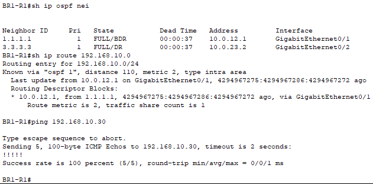
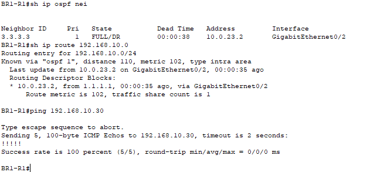
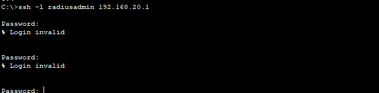
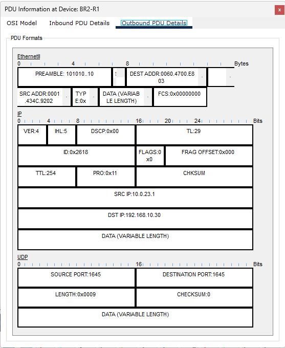
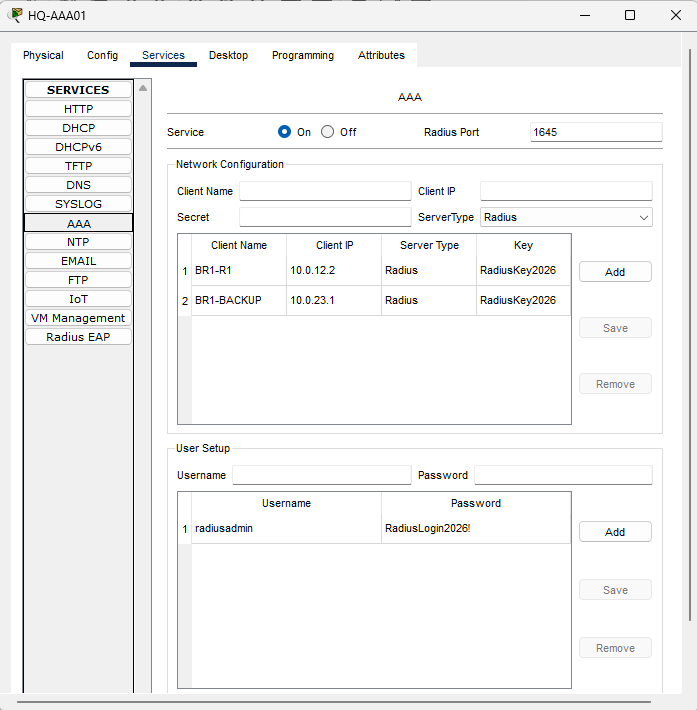
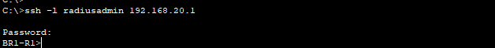
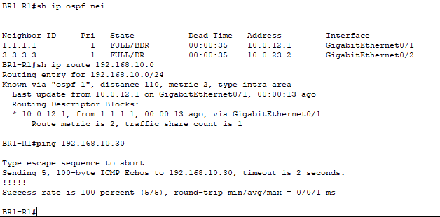

# Multisite RADIUS Failover Investigation

Investigated an SSH authentication failure during an OSPF WAN failover in Cisco Packet Tracer. IP connectivity to the RADIUS server remained available, but authentication failed because requests used an unregistered backup source address. Registering that address restored RADIUS login over the backup path.

## Objectives

- Establish routing and authentication baselines.
- Simulate failure of BR1's direct HQ link.
- Distinguish network reachability from authentication service success.
- Inspect a RADIUS packet to identify its source address.
- Correct the server client registration and verify backup and primary access.

## Environment

Cisco Packet Tracer 8.2.2, Cisco 2911 routers, Cisco 2960 switches, and a Server-PT AAA server. This project extends the existing multisite OSPF and AAA/RADIUS lab.

| Component | Address | Purpose |
| --- | --- | --- |
| HQ-PC1 | 192.168.10.10 | Authorized SSH management workstation |
| HQ-AAA01 | 192.168.10.30/24 | RADIUS server; default gateway 192.168.10.1 |
| BR1-R1 G0/0 | 192.168.20.1/24 | SSH destination |
| BR1-R1 G0/1 | 10.0.12.2/30 | Direct HQ link and primary RADIUS source |
| HQ next hop | 10.0.12.1 | Preferred BR1 route toward HQ |
| BR1-R1 G0/2 | 10.0.23.1/30 | Backup link and observed backup RADIUS source |
| BR2 next hop | 10.0.23.2 | Alternate BR1 route toward HQ |

The WAN links are in OSPF area 0. BR1's branch-to-branch interface has cost 100. The HQ LAN route normally has metric 2 and changes to metric 102 during the direct-link outage. The existing SSH-MGMT access-class permits HQ-PC1, and VTY access remains SSH-only.

## Starting Authentication Configuration

BR1 retained the working configuration from the previous lab:

```text
aaa new-model
aaa authentication login default local
aaa authentication login SSH-RADIUS group radius local
radius server HQ-AAA01
 address ipv4 192.168.10.30 auth-port 1645
 key RadiusKey2026
exit
line vty 0 4
 access-class SSH-MGMT in
 exec-timeout 5 0
 login authentication SSH-RADIUS
 transport input ssh
```

HQ-AAA01 initially registered only BR1's primary client IP, **10.0.12.2**. Its AAA service remained On during the WAN failure test. The server account was `radiusadmin` with password `RadiusLogin2026!`. These credentials and the shared secret are disposable lab examples.

The local fallback account from the previous lab was retained. This investigation used the server account to test centralized authentication, rather than treating a local login as proof of RADIUS success.

## Investigation

### 1. Establish the baseline

On BR1:

```text
show ip ospf neighbor
show ip route 192.168.10.0
ping 192.168.10.30
```

Both HQ (router ID 1.1.1.1) and BR2 (3.3.3.3) were FULL neighbors. The HQ LAN route used **10.0.12.1 on G0/1**, metric **2**, and the server answered **5/5** pings. A fresh SSH login from HQ-PC1 succeeded:

```text
ssh -l radiusadmin 192.168.20.1
```

### 2. Fail the direct HQ link

From BR1's direct CLI:

```text
configure terminal
interface gigabitEthernet0/1
shutdown
end
```

After convergence, BR2 remained FULL on G0/2. The route to 192.168.10.0/24 used **10.0.23.2**, metric **102**, and HQ-AAA01 still answered **5/5** pings.

Despite that connectivity, a new radiusadmin SSH login displayed `% Login invalid`. The successful ping confirmed ICMP reachability; it did not prove that the RADIUS server recognized the requesting client.

### 3. Inspect the authentication packet

Packet Tracer Simulation mode was filtered to RADIUS. A new SSH authentication attempt generated traffic that was inspected using **Outbound PDU Details** at BR2-R1.

| Observed field | Value |
| --- | --- |
| Source IP | 10.0.23.1 |
| Destination IP | 192.168.10.30 |
| UDP destination port | 1645 |

The packet showed BR1's request traversing BR2 with the backup interface address as its source. That address differed from the server's registered client IP, 10.0.12.2.

### 4. Apply the supported fix

An attempt to inspect `ip radius source-interface ?` returned an unrecognized-command response on this simulated router. A fixed source-interface configuration was therefore not implemented.

Instead, on **HQ-AAA01 → Services → AAA**, an additional client was registered while keeping the original entry:

| Client name | Client IP | Type | Shared secret |
| --- | --- | --- | --- |
| BR1-R1 | 10.0.12.2 | RADIUS | RadiusKey2026 |
| BR1-BACKUP | 10.0.23.1 | RADIUS | RadiusKey2026 |

With G0/1 still shut down, a fresh radiusadmin SSH login succeeded. The observed source mismatch and successful retest after registration support the client-registration mismatch as the cause of the failure.

### 5. Restore and verify the primary path

```text
configure terminal
interface gigabitEthernet0/1
no shutdown
end
```

Verification showed both OSPF neighbors FULL, the HQ LAN route restored through **10.0.12.1**, metric **2**, and **5/5** successful server pings. A new radiusadmin login was reported successful after restoration.

The BR1 configuration was saved with `copy running-config startup-config`, and the Packet Tracer project was saved with both server client registrations retained.

## Results

| Condition | HQ server ping | Fresh RADIUS login |
| --- | --- | --- |
| Primary link available | 5/5 replies | Successful |
| Primary down; backup source unregistered | 5/5 replies | Failed |
| Primary down; backup source registered | Reachability established over backup | Successful |
| Primary restored; both sources registered | 5/5 replies | Successful |

## Evidence

### Primary baseline



### Backup routing remains available



### Authentication failure during failover



### Observed RADIUS source IP



### Server client registrations



### Successful backup-path login



### Primary route restored



## Lessons and Scope

- Routing failover can preserve IP connectivity while an application-level dependency fails.
- RADIUS client registration must match the source address actually used by the router.
- Packet inspection helps distinguish source identity problems from routing failures.
- Registering both observed source addresses was the tested workaround in this simulator; a consistent source address was not configured.

This test verified new logins after routing convergence. It did not measure convergence time, guarantee uninterrupted existing SSH sessions, or test failure of both WAN paths. The server remained online throughout the WAN test. Centralized authorization and accounting were outside scope. The router's shared secret was visible in configuration; this project is a learning lab, not a production security design.

## Lab File

Download [multisite-radius-failover.pkt](multisite-radius-failover.pkt) and open it in Cisco Packet Tracer. Perform SSH tests from HQ-PC1 and link changes from BR1's direct CLI.
